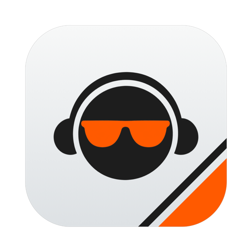
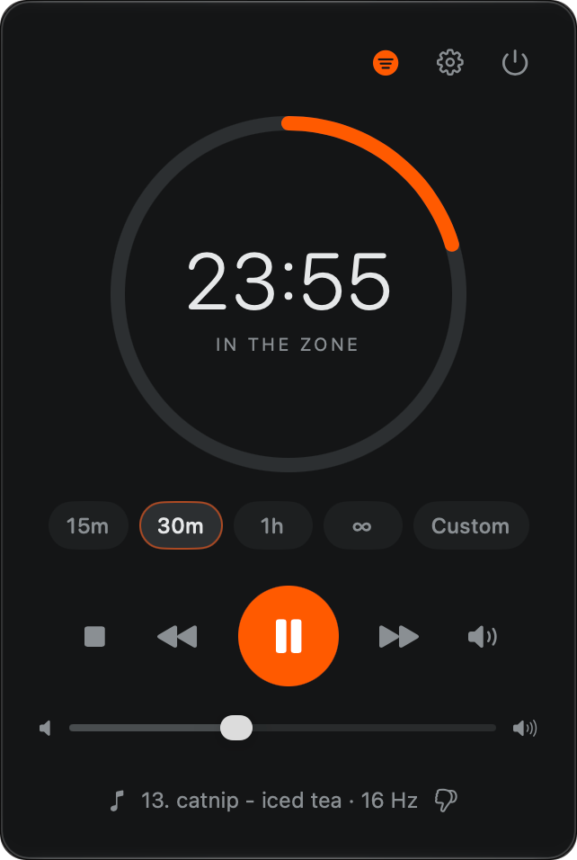
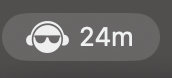

<p align="center">
  
</p>

<h1 align="center">Zone</h1>

<p align="center">
  <b>A focus timer for your Mac that plays music while you work.</b><br>
  Pick a length, press play, get in the zone.
</p>

<p align="center">
  
</p>

## What it does

- **One button for timer and music.** Choose 15 minutes, 30, an hour, open-ended (∞), or type any length.
  Play starts both, pause stops both. When time's up, the music fades out and a chime lets you know.
- **Music included.** Zone comes with 13 original tracks made for focus, from calm rain-window vibes to
  upbeat grooves. Want your own? Point it at any folder of songs.
- **Pick the mood.** Filter by tags like *calm*, *motivating* or *no vocals*. Don't like a song?
  Thumbs-down and it never plays again.
- **Distractions blocked.** During a session, YouTube and Netflix get swapped for a gentle "stay in the zone"
  page, and apps like WhatsApp are closed. You choose the list.
- **Focus modulation.** An optional 16 Hz pulse woven into the music, a rhythm linked to sustained attention
  ([Woods et al. 2024](https://pmc.ncbi.nlm.nih.gov/articles/PMC11499863/)).
- **Your Mac stays awake** until the session ends.
- **Lives in your menu bar** if you like, with the time left always in view:

  

## Install

You need macOS 15 or later and [Xcode](https://apps.apple.com/app/xcode/id497799835) (free).

```sh
git clone https://github.com/jnigri/zone.git
cd zone
make install
```

Then open Spotlight (⌘ Space), type **Zone**, press Return. That's it, the songs are ready to play.

## Tips

- **Keyboard:** Space plays and pauses, ⌘, opens Settings, Escape goes back.
- **Menu bar mode** (Settings) hides the Dock icon. Left-click the icon for the panel, right-click to play or pause.
- **Your own music:** Zone plays m4a, mp3, aac, wav and aiff files. Tags come from each file's Grouping field
  (comma-separated), which you can edit in the Music app's Get Info window or any tag editor.
  The refresh button in Filter picks up new songs.
- **Disliked songs** are listed at the bottom of Filter, where Restore brings them back.
- **Site blocking** works in Safari, Chrome, Arc, Brave, Edge and Vivaldi. macOS asks once per browser for
  permission; say no to leave that browser alone.
- **Site and app blocking are on by default.** Edit the lists or turn them off in Settings before your first session.

## Build from source

```sh
make app      # builds Zone.app
make run      # builds and opens it
```

Requires a Swift 6 toolchain. The build uses Xcode when installed, since some Command Line Tools releases lack
the SwiftUI macro plugin.

## License

The code is under the [MIT License](LICENSE). The songs in `Resources/Music` are not: see
[their license](Resources/Music/LICENSE.md).
